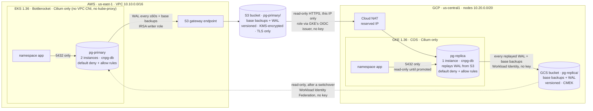

# poc-multicloud-postgres

A PostgreSQL primary on AWS (EKS) archives its WAL to S3, and a replica on Google
Cloud (GKE) replays it from there. The replica archives its own copy of the WAL, with
its own base backups, to GCS, so each cloud holds an independent copy of the backups.
The two form one CloudNativePG distributed topology, so either side can become the
primary through a commit to git (see
[Switchover, failover and failback](#switchover-failover-and-failback)). Both
Kubernetes clusters run Cilium as their only CNI, with default-deny network policies,
and Flux reconciles everything inside them from this repo.



There is no network path between the clouds, so there is no VPN. The replica's lag is
bounded by the primary's `archive_timeout` (60s).

## Deploy

The layers go up in this order. Each OpenTofu stack keeps its own state and finds the
layer below it by name, so the order matters in both directions.

| Step | What | Tool | Time |
| --- | --- | --- | --- |
| 1 | State backends (once) | `tofu apply` | 2 min |
| 2 | Networks | `tofu apply` | 3–5 min |
| 3 | Clusters | `tofu apply` | 12–15 min (EKS) |
| 4 | Platform: Cilium, CoreDNS, Flux, then Flux installs the rest | `make bootstrap` | 5–8 min |
| 5 | Archives: S3 and GCS buckets, IAM, Workload Identity Federation | `tofu apply` | 2–3 min |
| 6 | Credentials: the app owner on both clusters | `make app-credentials` | 1 min |
| 7 | Primary on EKS: network policies, then the database | `make data-vars` | 5 min + first backup |
| 8 | Replica on GKE: network policies, then the database | `make data-vars` | 5 min + first backup |

### Prerequisites

- An AWS account and a GCP project with billing, and admin credentials for both on your
  machine: `aws configure` (or SSO), `gcloud auth login` and
  `gcloud auth application-default login`.
- Tools: `tofu`, `aws` (v2), `gcloud` with `gke-gcloud-auth-plugin`, `kubectl`, `helm`,
  `flux`, `cilium`, `hubble`, the `kubectl cnpg` plugin and `gh`. Versions used for
  development are in `.tool-versions`.
- Flux reads this private repo with a **read-only deploy key**. Create it once; the
  private half stays under `secrets/`, which is gitignored:

  ```sh
  ssh-keygen -t ed25519 -N '' -C flux -f secrets/flux-deploy-key
  gh repo deploy-key add secrets/flux-deploy-key.pub --title flux
  ```

- Flux syncs from `main`, so deploy from an up-to-date `main`.

Set these once per shell. The helpers configure each stack's remote backend from the
bootstrap outputs, so no account-specific values are committed:

```sh
export GCP_PROJECT=<your-gcp-project-id>
export MY_IP="$(curl -s https://checkip.amazonaws.com)/32"   # only this IP may reach the K8s APIs

aws_init() {
  tofu -chdir="infra/$1" init \
    -backend-config="bucket=$(tofu -chdir=infra/00-bootstrap/aws output -raw state_bucket)" \
    -backend-config="region=us-east-1" \
    -backend-config="kms_key_id=$(tofu -chdir=infra/00-bootstrap/aws output -raw state_kms_key_arn)"
}
gcp_init() {
  tofu -chdir="infra/$1" init \
    -backend-config="bucket=$(tofu -chdir=infra/00-bootstrap/gcp output -raw state_bucket)"
}
```

### 1. State backends (once)

```sh
tofu -chdir=infra/00-bootstrap/aws init && tofu -chdir=infra/00-bootstrap/aws apply
tofu -chdir=infra/00-bootstrap/gcp init && tofu -chdir=infra/00-bootstrap/gcp apply -var project_id="$GCP_PROJECT"
```

These two stacks keep their own state locally (gitignored) because they create the
remote backends; keep those files. They are never torn down: buckets and keys have
`prevent_destroy`, and the GKE Secrets key and the GCS WAL bucket's key live here
because Cloud KMS keys can never be deleted. If you set up the GCP stack before the WAL
key and the EKS Workload Identity pool existed, apply it again to add them.

### 2. Networks

```sh
aws_init 10-network/aws && tofu -chdir=infra/10-network/aws apply
gcp_init 10-network/gcp && tofu -chdir=infra/10-network/gcp apply -var project_id="$GCP_PROJECT"
```

### 3. Clusters

```sh
aws_init 20-clusters/aws && tofu -chdir=infra/20-clusters/aws apply -var "api_allowed_cidrs=[\"$MY_IP\"]"
gcp_init 20-clusters/gcp && tofu -chdir=infra/20-clusters/gcp apply \
  -var project_id="$GCP_PROJECT" -var "api_allowed_cidrs=[\"$MY_IP\"]"

eval "$(tofu -chdir=infra/20-clusters/aws output -raw kubeconfig_command)"   # context: poc-mcpg
eval "$(tofu -chdir=infra/20-clusters/gcp output -raw kubeconfig_command)"
export EKS=poc-mcpg
export GKE="$(kubectl config get-contexts -o name | grep '^gke_')"
```

Nodes stay `NotReady` until Cilium is installed in the next step; that is expected.
Only the IAM principal that ran the apply is a cluster admin on EKS. If your IP
changes, re-apply with the new `MY_IP`.

### 4. Platform

```sh
make bootstrap CLOUD=aws CONTEXT="$EKS"
make bootstrap CLOUD=gcp CONTEXT="$GKE"
```

`make bootstrap` (`k8s/bootstrap.sh`) refuses to run against a cluster other than the
one the stack built. It then:

1. writes the cluster's account-specific values (API host, IAM role ARNs, DNS IP) from
   `tofu output` into the `flux-system/cluster-vars` ConfigMap
2. installs Cilium with Helm and waits for the agents, the operator and the nodes;
   on EKS it then installs CoreDNS, because Flux can't resolve `github.com` without it
3. installs Flux with the deploy key and points it at `k8s/clusters/<cloud>`

Flux takes over the Cilium and CoreDNS releases (same versions and values files) and
installs cert-manager, the CloudNativePG operator, the Barman Cloud plugin and, on EKS,
the EBS CSI driver.

```sh
flux --context "$EKS" get helmreleases -A          # all Ready
cilium --context "$EKS" status --wait
cilium --context "$GKE" status --wait
```

### 5. Archives in both clouds

```sh
aws_init 30-data/aws && tofu -chdir=infra/30-data/aws apply \
  -var "replica_egress_ips=$(tofu -chdir=infra/10-network/gcp output -json nat_egress_ips)" \
  -var gke_oidc_issuer_url="$(tofu -chdir=infra/20-clusters/gcp output -raw oidc_issuer_url)"
gcp_init 30-data/gcp && tofu -chdir=infra/30-data/gcp apply -var project_id="$GCP_PROJECT" \
  -var eks_oidc_issuer_url="$(tofu -chdir=infra/20-clusters/aws output -raw oidc_issuer_url)"
```

`infra/30-data/aws` creates the S3 bucket, `pg-primary`'s writer role (IRSA), and a
read-only role that `cnpg-db/pg-replica` assumes with a GKE service account token,
through an IAM OIDC provider that trusts the GKE cluster's issuer. `infra/30-data/gcp`
creates the GCS bucket, a Google service account that only `cnpg-db/pg-replica` can use
(Workload Identity), and a Workload Identity Federation provider that trusts the EKS
cluster's OIDC issuer, so `cnpg-db/pg-primary` can read the GCS bucket. Each stack
trusts the other cloud's cluster issuer, so no identity in either cloud has a
long-lived key. Both clusters need both archives: each one reads the other's to change
roles.

### 6. Credentials

```sh
make app-credentials EKS="$EKS" GKE="$GKE"
```

`make app-credentials` stores the same `app` owner credentials on both clusters, as
CloudNativePG requires for a distributed topology: `cnpg-db/app-owner`, which both
databases bootstrap with, and `app/postgres`, which clients in the `app` namespace
connect with (host `pg-primary-rw` on EKS, `pg-replica-rw` on GKE). The password is
generated once and goes straight into the Kubernetes API. Because it runs while both
clusters are up, GKE already holds the credentials if AWS is lost.

### 7. Primary on EKS

```sh
make data-vars CLOUD=aws CONTEXT="$EKS"
kubectl --context "$EKS" -n cnpg-db get cluster,backup -w
```

`make data-vars` stores the bucket names, region and writer role in the
`flux-system/data-vars` ConfigMap, and the GCS credential configuration (a token file
and a provider name, no key) in the `cnpg-db/gcs-reader` Secret. It refuses to run
until `make app-credentials` has. Flux applies nothing in `k8s/policies` or `k8s/data`
until the ConfigMap exists, so the database never starts with empty values. Flux then
applies the network policies first and the database only once they are ready, so no
database pod ever runs without default deny. Wait for `pg-primary` to be healthy and
its first backup to reach `completed`.

If a flow is missing from the policies, archiving or the backup stalls. Find the
dropped flow with Hubble rather than suspending the policies:

```sh
cilium --context "$EKS" hubble port-forward &
hubble observe -n cnpg-db --verdict DROPPED -f
```

### 8. Replica on GKE

```sh
make data-vars CLOUD=gcp CONTEXT="$GKE"
kubectl --context "$GKE" -n cnpg-db get cluster pg-replica -w
```

`make data-vars CLOUD=gcp` refuses to run until the primary's first base backup is in
S3, because the replica can't bootstrap without one.
Once the replica is ready it takes its first base backup to GCS; wait for it to reach
`completed` (`kubectl --context "$GKE" -n cnpg-db get backup`).

## End-to-end test on a local cluster

`make e2e` runs the data layer on a local single-node cluster, Rancher Desktop by
default, then breaks it on purpose and measures what happens. It uses the real
`k8s/data` manifests and the chart versions and values that Flux installs. A local S3
server (SeaweedFS) stands in for both clouds' object storage. Run it before changing
`k8s/data` or the operator versions, and before a live drill.

```sh
make e2e                    # about 20-30 minutes, then removes what it installed
E2E_KEEP=1 make e2e         # leave it running for inspection; make e2e-clean removes it
```

| # | Scenario | Checked | Measured |
| --- | --- | --- | --- |
| 1 | Replication | A row written on `pg-primary` reaches `pg-replica` | Lag after a WAL switch |
| 2 | Restore from the GCP copy | Point-in-time restore from `pg-replica`'s archive alone lands exactly on the target time | Restore time |
| 3 | Kill the primary pod | The other instance takes writes; no committed row is lost; archiving continues | Failover time |
| 4 | Object store outage | Writes continue; CloudNativePG reports archiving failing; the replica catches up afterwards | Time to detect, time to catch up |
| 5 | Planned switchover and back | Promotion tokens, no row lost, replication in both directions | Switchover time each way |
| 6 | Unplanned failover | The fenced primary refuses connections, and still does 60s later; `pg-replica` takes writes | Failover time, rows lost (RPO) |

Each run writes its results to `evidence/e2e/<UTC time>.md`; commit that file as the
record of the run. A failed run also saves cluster state and logs under
`test/e2e/results/` (gitignored).

How it differs from production, and so what it doesn't prove: the overlays in
`test/e2e/manifests` give every object store a static key in place of IRSA, GKE
Workload Identity and the two federations. They also use local volumes, smaller
resources, and preferred rather than required anti-affinity, because there is one
node. Cilium network policies aren't applied. Both archives live on one S3 server, and
both clusters share one node and one operator. Everything else, including the
distributed topology and `archive_timeout`, is what production runs. `make validate`
renders these overlays and checks them against the CRD schemas, so a change to
`k8s/data` that breaks them fails there first.

The script only runs against a context whose API server is on `localhost`, so it
can't touch a cloud cluster. It needs `kubectl`, `helm`, `kustomize`, `python3` and
`openssl`. Give Rancher Desktop's VM 4 CPUs and 8 GB (Preferences > Virtual Machine);
with less, the four PostgreSQL pods may wait for resources.

### Watching a run in Grafana

`E2E_MONITORING=1` also installs Prometheus and Grafana (`k8s/monitoring`) before the
databases, so the dashboard covers the whole run:

```sh
E2E_MONITORING=1 E2E_KEEP=1 make e2e   # in one terminal; keep it so Grafana outlives the run
make e2e-grafana                       # in another, once the run prints "Dashboard:"
open http://localhost:3000/d/postgres-dr
```

Grafana opens read-only without a login. The admin password is in the
`monitoring/kube-prometheus-stack-grafana` Secret. Give the VM about 10 GB with
monitoring on.

The dashboard, *PostgreSQL across clouds: recovery point and failover*, uses only
metrics CloudNativePG and the Barman Cloud plugin already serve on each instance's
port 9187. One PodMonitor scrapes them every 10s. Each scenario has its own shape:

| Panel | What it shows | Where the scenarios show up |
| --- | --- | --- |
| Role of each Cluster | Primary, replica, no primary (should be primary, nothing accepts writes) or fenced | 3: a few seconds of no primary. 5: the roles swap and swap back. 6: `pg-replica` turns primary, `pg-primary` fenced |
| PostgreSQL up, per instance | Whether each pod's PostgreSQL answers | 3: the killed pod drops out and comes back |
| Seconds since the last WAL segment was archived | Per Cluster, against `archive_timeout` (60s) | 4: the primary's line climbs past 60s until the store is back |
| WAL segments each archive is behind the newest | The replica's line is the cross-cloud lag | 1 and 4: it rises while the replica waits, then drops to 0 |
| WAL segments waiting to be archived | `.ready` files piling up on the WAL volume | 4: they pile up during the outage, then drain |
| Failed archive attempts | Per minute | 4 |
| Age of the last base backup, recovery window | Per archive, from the Barman Cloud plugin | 0: both archives get their first backup |
| Rows written per minute | Inserts, updates and deletes in `app`, per Cluster | Where each scenario's writes land |

In the end-to-end test both archives are the same local S3 server and replication
crosses no network, so the lag is shorter than on the clouds. The dashboard isn't
deployed to EKS and GKE yet. That needs a Flux Kustomization for `k8s/monitoring`,
and an allow rule in `k8s/policies` from the `monitoring` namespace to port 9187.

## Verify

```sh
# Cilium is the only CNI: no aws-node or kube-proxy on EKS, no anetd on GKE.
kubectl --context "$EKS" -n kube-system get daemonsets
kubectl --context "$GKE" -n kube-system get daemonsets | grep anetd   # no output

# Archiving and the base backup.
kubectl cnpg status pg-primary -n cnpg-db --context "$EKS"
aws s3 ls "s3://$(tofu -chdir=infra/30-data/aws output -raw wal_bucket)/pg-primary/"   # base/ and wals/

# End to end: a row written on AWS appears on GCP within about 1-2 minutes.
kubectl cnpg psql pg-primary -n cnpg-db --context "$EKS" -- -d app -c \
  "CREATE TABLE IF NOT EXISTS ping(ts timestamptz); INSERT INTO ping VALUES (now()); SELECT pg_switch_wal();"
kubectl cnpg psql pg-replica -n cnpg-db --context "$GKE" -- -d app -c \
  "SELECT max(ts) FROM ping; SELECT now() - pg_last_xact_replay_timestamp() AS lag;"

# The replica keeps its own copy in GCS: base/ and wals/ under pg-replica/.
gcloud storage ls "gs://$(tofu -chdir=infra/30-data/gcp output -raw wal_bucket)/pg-replica/"
kubectl cnpg status pg-replica -n cnpg-db --context "$GKE"   # WAL archiving OK, last backup

# The replica recovers from S3 after losing its pod.
kubectl --context "$GKE" -n cnpg-db delete pod pg-replica-1
kubectl cnpg status pg-replica -n cnpg-db --context "$GKE"

# Network policies: watch for drops while forcing a WAL switch and a backup.
hubble observe -n cnpg-db --verdict DROPPED -f
# The same flows as a live service map, allowed and dropped (Hubble UI, opens a browser):
cilium --context "$EKS" hubble ui
# No access from other namespaces (times out):
kubectl --context "$EKS" run nettest --rm -it --restart=Never -n default --image=postgres:18 -- \
  pg_isready -h pg-primary-rw.cnpg-db -t 5
# No internet from the database (fails):
kubectl --context "$EKS" -n cnpg-db exec pg-primary-1 -c postgres -- timeout 5 bash -c '</dev/tcp/example.com/443'
# The app namespace can reach the primary (accepting connections), on both sides;
# on GKE it is read-only until pg-replica is promoted:
kubectl --context "$EKS" run nettest --rm -it --restart=Never -n app --image=postgres:18 -- \
  pg_isready -h pg-primary-rw.cnpg-db -t 5
kubectl --context "$GKE" run nettest --rm -it --restart=Never -n app --image=postgres:18 -- \
  pg_isready -h pg-replica-rw.cnpg-db -t 5
```

## Switchover, failover and failback

`pg-primary` and `pg-replica` are the two members of one CloudNativePG
[distributed topology](https://cloudnative-pg.io/docs/current/replica_cluster). Each
`Cluster` lists both members in `externalClusters`, read through their archives, and
`spec.replica.primary` names the one primary. Every role change is a commit to
`replica.primary` in `k8s/data/aws/cluster.yaml` and `k8s/data/gcp/cluster.yaml`, which
Flux applies. `make validate` rejects any commit in which both name themselves the
primary, unless one of them is fenced in full (see
[Unplanned failover](#unplanned-failover-aws-is-lost)).

This replaces the plain `replica.enabled: false` promotion: with it, the operator
demotes the old primary cleanly and hands over a promotion token, so a planned
switchover loses nothing and needs no rebuild.

### Planned switchover to GCP

No data is lost. Writes are refused from step 1 until step 2 completes.

1. **Demote `pg-primary`.** Commit `replica.primary: pg-replica` in
   `k8s/data/aws/cluster.yaml` only, and let Flux apply it
   (`flux --context "$EKS" reconcile kustomization data --with-source`). `pg-primary`
   stops accepting writes, archives its last WAL to S3 and publishes a demotion token:

   ```sh
   kubectl --context "$EKS" -n cnpg-db get cluster pg-primary -o jsonpath='{.status.demotionToken}'
   ```

2. **Promote `pg-replica`.** In one commit to `k8s/data/gcp/cluster.yaml`, set
   `replica.primary: pg-replica` and `replica.promotionToken: <token>` together. The
   token isn't a secret: it holds the system identifier, timeline and checkpoint
   location. `pg-replica` replays up to that point, then promotes and starts a new
   timeline in GCS. `pg-primary` follows it from GCS.

3. **Move clients** to the `app` namespace on GKE. They connect with the `app/postgres`
   Secret already there.

Switching back is the same with the roles reversed. The validator makes you remove the
old `promotionToken` in the commit that demotes `pg-replica` again.

### Unplanned failover: AWS is lost

1. **Promote `pg-replica` and fence `pg-primary`, in one commit:**
   - `k8s/data/gcp/cluster.yaml`: `replica.primary: pg-replica`, with no token. It
     promotes at once, at the last WAL it replayed.
   - `k8s/data/aws/cluster.yaml`: only the annotation
     `cnpg.io/fencedInstances: '["*"]'` on `pg-primary`. Leave `replica.primary`
     as it is: demoting `pg-primary` restarts it, and CloudNativePG lifts the fence
     during that restart (`make e2e` showed it). `make validate` accepts both
     clusters naming themselves the primary only while one is fenced in full.

2. **Move clients** to the `app` namespace on GKE, as above.

**Data lost:** what `pg-primary` wrote after the last WAL `pg-replica` fetched. That's
up to `archive_timeout` (60s) plus however far the replica was behind.

**Fencing.** When EKS comes back, Flux's first reconcile applies the fence, and
CloudNativePG stops PostgreSQL in every `pg-primary` instance: it accepts no
connections and archives nothing more. Demotion wouldn't help, because a primary
that was failed over without a token has diverged and can't follow the new one, and
it lifts the fence.
What this doesn't cover is the gap between EKS returning and Flux reconciling: the old
instances can start as primary for that window. Anything written then is lost, but it
only ever reaches `pg-primary/` in S3, never `pg-replica`'s archive, so the new
timeline can't be contaminated. Closing that gap needs a fence that doesn't depend on
the old cluster, such as cutting its clients off at the network or a witness. That's
listed under Known gaps.

### Failback to AWS after a failover

The fenced `pg-primary` has diverged, so it's rebuilt from `pg-replica`'s GCS archive,
then switched back with a planned switchover:

```sh
# 1. Keep Flux from recreating pg-primary from the old spec.
flux --context "$EKS" suspend kustomization data

# 2. Delete the old cluster, its claims and their retained volumes.
kubectl --context "$EKS" -n cnpg-db delete cluster pg-primary
kubectl --context "$EKS" -n cnpg-db delete pvc -l cnpg.io/cluster=pg-primary
kubectl --context "$EKS" get pv   # delete the Released pg-primary volumes

# 3. Set the old archive aside: Barman won't archive into a prefix that holds
#    another history. The writer role can't touch the new prefix.
bucket=$(tofu -chdir=infra/30-data/aws output -raw wal_bucket)
aws s3 mv --recursive "s3://$bucket/pg-primary/" "s3://$bucket/pg-primary-diverged-$(date +%Y%m%d)/"
```

4. Commit to `k8s/data/aws/cluster.yaml`: replace `bootstrap.initdb` with
   `bootstrap.recovery` from `pg-replica` (same `database`, `owner` and `secret`),
   remove the fence annotation, and set `replica.primary: pg-replica`.
5. `flux --context "$EKS" resume kustomization data`. `pg-primary` is recreated from
   GCS as a replica of `pg-replica`.
6. Once it has caught up, run a planned switchover back to AWS. Then restore
   `bootstrap.initdb` in git, so a fresh build still starts from an empty database.

Losing GCP while AWS is the primary is the mirror image: rebuild `pg-replica` from S3,
after setting `gs://<bucket>/pg-replica/` aside.

**Client cutover stops at the cluster boundary.** Applications in the `app` namespace
on either cluster reach their local primary through the `<cluster>-rw` Service.
Routing clients outside the clusters (a DNS name that follows the primary, or global
traffic management) is out of scope for a database PoC. It would take a DNS record
switched in the same commit (for example with external-dns), and each `-rw` Service
exposed through an internal load balancer on the clients' network.

## Tear down

Tear down in reverse. The order is required, not just tidy:

- Each stack looks up the one below it, so `30-data` must go before `20-clusters`, and
  `20-clusters` before `10-network`.
- The database StorageClasses keep their volumes (`reclaimPolicy: Retain`), so that no
  mistake deletes data. Tearing down is the one time you want the volumes gone: switch
  them to `Delete` first, or the EBS and Persistent Disk volumes stay behind, still
  billed.

```sh
# 1. Stop Flux from recreating anything, mark the database volumes for deletion,
#    then delete the databases (and with them their volumes).
for ctx in "$EKS" "$GKE"; do
  flux --context "$ctx" suspend kustomization --all
  kubectl --context "$ctx" get pv -o jsonpath='{range .items[?(@.spec.claimRef.namespace=="cnpg-db")]}{.metadata.name}{"\n"}{end}' |
    while read -r pv; do
      kubectl --context "$ctx" patch pv "$pv" -p '{"spec":{"persistentVolumeReclaimPolicy":"Delete"}}'
    done
done
kubectl --context "$GKE" -n cnpg-db delete cluster pg-replica
kubectl --context "$EKS" -n cnpg-db delete cluster pg-primary
kubectl --context "$EKS" get pv; kubectl --context "$GKE" get pv   # wait until empty

# 2. Cloud resources, top layer first. 30-data empties the buckets and removes
#    the cross-cloud trust (the IAM OIDC provider and the GCP federation provider).
tofu -chdir=infra/30-data/gcp destroy -var project_id="$GCP_PROJECT" \
  -var eks_oidc_issuer_url="$(tofu -chdir=infra/20-clusters/aws output -raw oidc_issuer_url)"
tofu -chdir=infra/30-data/aws destroy \
  -var "replica_egress_ips=$(tofu -chdir=infra/10-network/gcp output -json nat_egress_ips)" \
  -var gke_oidc_issuer_url="$(tofu -chdir=infra/20-clusters/gcp output -raw oidc_issuer_url)"
tofu -chdir=infra/20-clusters/gcp destroy -var project_id="$GCP_PROJECT" -var "api_allowed_cidrs=[\"$MY_IP\"]"
tofu -chdir=infra/20-clusters/aws destroy -var "api_allowed_cidrs=[\"$MY_IP\"]"
make cilium-enis            # lists ENIs Cilium left in the VPC; DELETE=1 removes them
tofu -chdir=infra/10-network/gcp destroy -var project_id="$GCP_PROJECT"
tofu -chdir=infra/10-network/aws destroy
```

The state backends stay. In ENI mode the Cilium operator creates ENIs and
garbage-collects the unattached ones every 5 minutes, but once the cluster is gone
nothing does, and a leftover ENI blocks the VPC's destroy. `make cilium-enis` lists
the unattached ENIs in this VPC tagged `io.cilium/cilium-managed=true`, and with
`DELETE=1` deletes exactly those. When you're done with the project for good, also remove the deploy key
(`gh repo deploy-key delete`) and `secrets/flux-deploy-key*`.

## Design

**Kubernetes is the portability layer.** OpenTofu manages cloud primitives only
(networks, NAT, clusters, buckets, IAM) and has no Helm or Kubernetes providers; a
pre-commit hook enforces that. Everything inside the clusters is Helm and kustomize,
reconciled by Flux, and nearly identical on both clouds.

**Archive-only replication.** The replica follows the primary through the S3 WAL
archive, with an RPO of about `archive_timeout` (60s). In exchange there's no VPN, no
inbound path between the clouds and little to operate. Streaming replication over an
HA VPN is the upgrade path if lag must be lower.

**An independent copy of the backups in each cloud.** `pg-primary` archives to S3
in `us-east-1`. `pg-replica` replays from there and, as a CloudNativePG replica cluster,
runs with `archive_mode=always`: every WAL segment it replays is archived again to its
own GCS bucket in `us-central1`, and it takes its own nightly base backups there. The
GCS copy is written by a GCP identity, with a GCP key, under `pg-replica/`, so nothing
on the GCP side needs AWS to recover, and a promoted replica keeps archiving to the
same place without a change. The cost is a second archive (about 1,440 WAL segments a
day at `archive_timeout` 60s, gzip-compressed) and a second base backup.

What still works when one cloud is lost:

| Lost | Data | Still works | What's lost or degraded |
| --- | --- | --- | --- |
| AWS `us-east-1` | GCS holds `pg-replica`'s base backups and every WAL segment it replayed | Fail over to `pg-replica` (see [Unplanned failover](#unplanned-failover-aws-is-lost)); it keeps archiving to GCS and taking backups, so it has PITR from the first GCS base backup on, and serves clients in GKE's `app` namespace. If its volume is also lost, a new cluster can be restored from GCS | Writes since the last WAL the replica replayed: up to `archive_timeout` (60s), plus anything S3 held that the replica hadn't fetched yet. Applications on EKS |
| GCP `us-central1` | S3 holds `pg-primary`'s base backups and WAL | The primary, its archive and its backups are unaffected | The DR copy and the GCS backups. Rebuild the replica from S3 (step 8) once GCP is back |
| Only one Kubernetes cluster | Both buckets | The other side as above; the lost side is rebuilt from its own bucket or the other cloud's | |

Two limits of this design. The GCS copy can only be as current as the replica: if the
replica stops replaying, the GCS archive stops too, so replication lag is also the age
of the GCP backups. And Barman won't archive into a prefix that already holds another
cluster's history, so a cluster restored from GCS must archive under a new name (a
different `serverName`, or a new bucket), never back into `pg-replica/` or `pg-primary/`.

**Self-managed Cilium on both clouds.** Both clusters run the same pinned Cilium
release as their only CNI: in ENI mode on EKS, with no VPC CNI, kube-proxy or managed
CoreDNS, and on GKE's legacy datapath rather than Dataplane V2, which is Google's
managed Cilium. It's a deliberate trade-off, and the costs are real.

What it buys:

- **One policy model on both clouds.** The default deny is built on
  `CiliumNetworkPolicy` FQDN egress rules (S3, STS, GCS). A plain `NetworkPolicy`
  can't express "only this hostname". Dataplane V2 and the VPC CNI's network policy
  agent enforce `NetworkPolicy`, but FQDN egress there means another API per cloud
  (or IP ranges that change), so the policies would be written and tested twice.
- **The same datapath and the same tools everywhere.** One Cilium version, one set of
  values, and Hubble on both clusters, so a dropped flow is debugged the same way on
  either side, and policy behavior is tested once.
- **A cloud-neutral layer.** Kubernetes is the portability layer here; with the CNI in
  `k8s/`, everything above the cloud primitives is the same on both clouds.

What it costs:

- **A bootstrap step.** Nothing runs before the CNI, and on EKS Flux can't resolve
  `github.com` before CoreDNS, so `bootstrap.sh` installs Cilium and CoreDNS with Helm
  before Flux exists. Flux then adopts the same releases. Both read the same values
  files, and `make validate` checks that the versions match, so the two can't drift.
- **Upgrades are ours.** Google and AWS upgrade Dataplane V2 and the VPC CNI with the
  cluster; here the team must. Cilium also bounds the Kubernetes version: 1.36 is the
  newest minor that Cilium 1.20 is tested against (`infra/modules/settings`).
- **Support and teardown.** A CNI problem isn't the cloud provider's to fix, and in ENI
  mode the operator's ENIs outlive the cluster (`make cilium-enis`, above).

When managed networking is the better choice: when L3/L4 `NetworkPolicy` is enough,
when the team has no Cilium experience to own upgrades and incidents, or when only one
cloud is in play. Then Dataplane V2 on GKE, and the VPC CNI with its network policy
agent on EKS, remove the bootstrap step and the upgrade work. A middle ground on EKS is
Cilium in chaining mode on top of the VPC CNI: AWS keeps IPAM and ENIs, and Cilium
adds FQDN policy and Hubble. For this PoC, identical FQDN egress policy on both clouds
was the requirement that decided it.

**Upgrading Cilium**, one minor at a time, always before the Kubernetes minor that
needs it:

1. Read the upgrade notes for the target release, and set `upgradeCompatibility` in
   `k8s/platform/base/cilium/values.yaml` to the version you're upgrading from.
2. Bump the chart version in `k8s/platform/base/cilium/helmrelease.yaml` and
   `CILIUM_VERSION` in `k8s/bootstrap.sh` together (`make validate` fails if they
   differ), then merge. Flux upgrades the release, and the agents roll one node at a
   time.
3. Check `cilium status --wait` and `hubble observe --verdict DROPPED` on both
   clusters, then remove `upgradeCompatibility`.
4. Only then raise `kubernetes.version` in `infra/modules/settings`, within the range
   the new Cilium release is tested against.

**Least privilege.**

| Identity | Can | Only |
| --- | --- | --- |
| WAL writer (IRSA, `cnpg-db/pg-primary`) | List, read, write, delete | `pg-primary/`, through the VPC's S3 gateway endpoint; the KMS key through S3 |
| WAL reader (IAM role, `cnpg-db/pg-replica` on GKE through its OIDC issuer) | List, read | `pg-primary/`, from the GCP Cloud NAT IP; decrypt through S3; only tokens with the `sts.amazonaws.com` audience |
| GCS WAL writer (Workload Identity, `cnpg-db/pg-replica`) | List, read, write, delete objects; read bucket metadata | The GCS WAL bucket; no project-level roles |
| GCS WAL reader (Workload Identity Federation, `cnpg-db/pg-primary` on EKS) | List, read objects; read bucket metadata | The GCS WAL bucket; only tokens from this EKS cluster's issuer for this service account |
| Cilium operator (IRSA) | The ENI calls in Cilium's docs | This account and region |
| EBS CSI driver (IRSA) | AWS's EBS CSI policy | |

Kubernetes Secrets are encrypted with customer-managed KMS keys on both clouds. The
public API endpoints accept only `api_allowed_cidrs`, nodes have no public IPs, and nodes run
hardened container OSes (Bottlerocket with no SSH or SSM and kernel lockdown;
Container-Optimized OS with Shielded VM). No identity has a long-lived key: every
credential is a service account token exchanged for short-lived cloud credentials,
within its own cloud (IRSA, GKE Workload Identity) or across (an IAM OIDC provider for
GKE's issuer, GCP Workload Identity Federation for EKS's). A pre-commit hook rejects
`aws_iam_access_key` in OpenTofu.

**Network policies.** Every pod in `cnpg-db` starts from default deny, and Cilium
rules open only these flows. Flux applies them before the databases (the `data` layer
depends on `policies`), so no database pod ever runs unprotected:

| # | Direction | From → to | Ports | Cluster |
| --- | --- | --- | --- | --- |
| 1 | Egress | All pods → `kube-dns`, through Cilium's DNS proxy | 53 | Both |
| 2 | Egress | All pods → `kube-apiserver` | 443 | Both |
| 3 | Ingress | CNPG operator → instances; kubelet probes | 8000, 5432 | Both |
| 4 | Both | Instance ↔ instance of the same cluster | 5432, 8000 | Both |
| 5 | Egress | Database pods → the bucket's regional S3 endpoints, by name | 443 | Both |
| 6 | Egress | Database pods → AWS STS (IRSA on EKS, web identity on GKE) | 443 | Both |
| 7 | Ingress | Namespace `app` → the cluster's current (or designated) primary only | 5432 | Both |
| 8 | Egress | Database pods → `storage.googleapis.com` | 443 | GKE |
| 9 | Egress | Database pods → GKE metadata server (Workload Identity tokens) | 80 | GKE |
| 10 | Egress | Database pods → `sts.googleapis.com`, `storage.googleapis.com` | 443 | EKS |

**Shared settings and module interfaces.** `infra/modules/settings` holds the values
both clouds share (names, regions, zones, address plan, Kubernetes version, node OS,
labels), and validation rejects overlapping address ranges. Each cloud has its own
module per concern (`network`, `network-lookup`, `cluster`) rather than one module with
a `cloud` switch, so each stack needs one provider and one set of credentials. OpenTofu
has no way to declare a module interface, so two checks keep the AWS and GCP modules
interchangeable for callers: `scripts/check_module_contracts.py` checks that the inputs
and outputs in each `contract.json` are declared, and `infra/tests/contracts` checks the
values the outputs produce.

**Separate state per layer, joined by data sources.** Later stacks find the layers
below them by name (`network-lookup`, EKS and KMS data sources), not through
`terraform_remote_state`, so a stack needs only read access in the cloud, never another
stack's state file.

## Repository layout

| Path | Contents |
| --- | --- |
| `infra/modules/settings` | Values both clouds share |
| `infra/modules/{network,network-lookup,cluster}/{aws,gcp}` | One module per cloud behind a shared `contract.json` |
| `infra/00-bootstrap/{aws,gcp}` | State buckets and long-lived KMS keys |
| `infra/10-network/{aws,gcp}` | VPCs, subnets, NAT, S3 gateway endpoint, firewall |
| `infra/20-clusters/{aws,gcp}` | EKS and GKE without a default CNI; IRSA roles |
| `infra/30-data/aws` | S3 WAL bucket, KMS key, writer role, and the GKE reader role through an IAM OIDC provider |
| `infra/30-data/gcp` | GCS WAL bucket for the replica's own archive, its Workload Identity writer, and the EKS reader through Workload Identity Federation |
| `infra/tests/contracts` | Contract tests for the per-cloud modules |
| `k8s/flux` | Flux controllers (generated, images pinned by digest) |
| `k8s/clusters/{aws,gcp}` | Each cluster's Flux entry point and `*.example.env` variable lists |
| `k8s/platform` | Cilium, CoreDNS, cert-manager, CloudNativePG, Barman plugin, EBS CSI |
| `k8s/data` | The PostgreSQL clusters, object stores and backups |
| `k8s/policies` | Default deny and Cilium allow rules for `cnpg-db` |
| `k8s/monitoring` | Prometheus, Grafana, the PodMonitor and the PostgreSQL dashboard (used by `make e2e` so far) |
| `k8s/*.sh` | `bootstrap.sh`, `data-vars.sh`, `app-credentials.sh` (run through `make`) |
| `test/e2e` | The local end-to-end test (`make e2e`) and its overlays of `k8s/data` |
| `evidence/e2e` | Results of end-to-end runs |

## Local validation

```sh
brew install opentofu trivy gitleaks pre-commit checkov helm kustomize kubeconform shellcheck
brew install terraform-linters/tap/tflint fluxcd/tap/flux
make hooks      # pre-commit and commit-msg hooks
make validate   # every check below; no cloud credentials needed
```

`make validate` runs, without touching any cloud API or state backend:

1. `tofu fmt`, `tofu validate` and `tofu test` (mock providers) in every stack and module
2. pre-commit: gitleaks, checkov, trivy and tflint for OpenTofu, shellcheck, file
   hygiene, and project guardrails (no `aws_iam_access_key`, no in-cluster providers in
   OpenTofu, module contracts)
3. the Kubernetes layer (`scripts/validate_k8s.py`), for every Flux layer of each cluster:
   - kustomize builds validated with kubeconform against Kubernetes 1.36 and strict
     schemas generated from the CRDs that Flux, the pinned charts and Cilium install
   - `helm template` of every `HelmRelease` at its pinned version, and every values key
     checked against the chart's schema
   - checkov's Kubernetes checks on the manifests exactly as Flux applies them
   - `${VARS}` checked against the `*.example.env` files, and `bootstrap.sh` and the Flux
     image digests checked against what Flux manages
   - the end-to-end test's overlays rendered and validated the same way
4. `gitleaks` over the full git history

CI runs `make validate` on every pull request and on pushes to `main`, with a read-only
token and no cloud credentials.

## Known gaps and next steps

- HA VPN and streaming replication, for lag under a minute.
- Run the switchover, failover and failback drills on live clusters, and record RTO
  and RPO. `make e2e` measures them locally; the live drill, with real identities,
  network policies and cross-cloud latency, hasn't been run yet. Failback after an
  unplanned failover (rebuilding from the other archive) isn't in `make e2e` yet.
- A fence that doesn't depend on the old primary's cluster reconciling first, and
  client routing across clouds (DNS that follows the primary).
- Prometheus and the dashboard on EKS and GKE (see
  [Watching a run in Grafana](#watching-a-run-in-grafana)), alerts on archive failures
  and replica lag; regional, multi-AZ clusters; one NAT gateway per AZ.
- Cluster-wide default deny (`cnpg-system`, `kube-system`) and security-group-level
  egress filtering on the EKS nodes.
