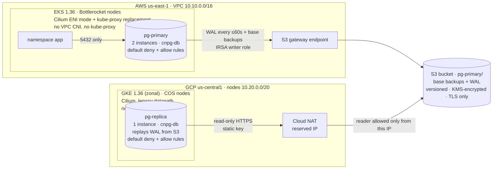

# poc-multicloud-postgres

A PostgreSQL primary on AWS (EKS) archives its WAL to S3, and a replica on Google
Cloud (GKE) replays it from there. Both Kubernetes clusters run Cilium as their only
CNI, with default-deny network policies, and Flux reconciles everything inside them
from this repo.



There is no network path between the clouds, so there is no VPN. The replica's lag is
bounded by the primary's `archive_timeout` (60s).

## Deploy

The layers go up in this order. Each OpenTofu stack keeps its own state and finds the
layer below it by name, so the order matters in both directions.

| Step | What | Tool | Time |
| --- | --- | --- | --- |
| 1 | State backends (once) | `tofu apply` | 2 min |
| 2 | Networks | `tofu apply` | 3–5 min |
| 3 | Clusters | `tofu apply` | 12–15 min (EKS) |
| 4 | Platform: Cilium, CoreDNS, Flux, then Flux installs the rest | `make bootstrap` | 5–8 min |
| 5 | Primary: WAL bucket and IAM, then the database | `tofu apply`, `make data-vars` | 5 min + first backup |
| 6 | Replica | `make replica-credentials`, `make data-vars` | 5 min |
| 7 | Network policies | automatic, after steps 5–6 | 1 min |

### Prerequisites

- An AWS account and a GCP project with billing, and admin credentials for both on your
  machine: `aws configure` (or SSO), `gcloud auth login` and
  `gcloud auth application-default login`.
- Tools: `tofu`, `aws` (v2), `gcloud` with `gke-gcloud-auth-plugin`, `kubectl`, `helm`,
  `flux`, `cilium`, `hubble`, the `kubectl cnpg` plugin and `gh`. Versions used for
  development are in `.tool-versions`.
- Flux reads this private repo with a **read-only deploy key**. Create it once; the
  private half stays under `secrets/`, which is gitignored:

  ```sh
  ssh-keygen -t ed25519 -N '' -C flux -f secrets/flux-deploy-key
  gh repo deploy-key add secrets/flux-deploy-key.pub --title flux
  ```

- Flux syncs from `main`, so deploy from an up-to-date `main`.

Set these once per shell. The helpers configure each stack's remote backend from the
bootstrap outputs, so no account-specific values are committed:

```sh
export GCP_PROJECT=<your-gcp-project-id>
export MY_IP="$(curl -s https://checkip.amazonaws.com)/32"   # only this IP may reach the K8s APIs

aws_init() {
  tofu -chdir="infra/$1" init \
    -backend-config="bucket=$(tofu -chdir=infra/00-bootstrap/aws output -raw state_bucket)" \
    -backend-config="region=us-east-1" \
    -backend-config="kms_key_id=$(tofu -chdir=infra/00-bootstrap/aws output -raw state_kms_key_arn)"
}
gcp_init() {
  tofu -chdir="infra/$1" init \
    -backend-config="bucket=$(tofu -chdir=infra/00-bootstrap/gcp output -raw state_bucket)"
}
```

### 1. State backends (once)

```sh
tofu -chdir=infra/00-bootstrap/aws init && tofu -chdir=infra/00-bootstrap/aws apply
tofu -chdir=infra/00-bootstrap/gcp init && tofu -chdir=infra/00-bootstrap/gcp apply -var project_id="$GCP_PROJECT"
```

These two stacks keep their own state locally (gitignored) because they create the
remote backends; keep those files. They are never torn down: buckets and keys have
`prevent_destroy`, and the GKE Secrets key lives here because Cloud KMS keys can never
be deleted.

### 2. Networks

```sh
aws_init 10-network/aws && tofu -chdir=infra/10-network/aws apply
gcp_init 10-network/gcp && tofu -chdir=infra/10-network/gcp apply -var project_id="$GCP_PROJECT"
```

### 3. Clusters

```sh
aws_init 20-clusters/aws && tofu -chdir=infra/20-clusters/aws apply -var "api_allowed_cidrs=[\"$MY_IP\"]"
gcp_init 20-clusters/gcp && tofu -chdir=infra/20-clusters/gcp apply \
  -var project_id="$GCP_PROJECT" -var "api_allowed_cidrs=[\"$MY_IP\"]"

eval "$(tofu -chdir=infra/20-clusters/aws output -raw kubeconfig_command)"   # context: poc-mcpg
eval "$(tofu -chdir=infra/20-clusters/gcp output -raw kubeconfig_command)"
export EKS=poc-mcpg
export GKE="$(kubectl config get-contexts -o name | grep '^gke_')"
```

Nodes stay `NotReady` until Cilium is installed in the next step; that is expected.
Only the IAM principal that ran the apply is a cluster admin on EKS. If your IP
changes, re-apply with the new `MY_IP`.

### 4. Platform

```sh
make bootstrap CLOUD=aws CONTEXT="$EKS"
make bootstrap CLOUD=gcp CONTEXT="$GKE"
```

`make bootstrap` (`k8s/bootstrap.sh`) refuses to run against a cluster other than the
one the stack built. It then:

1. writes the cluster's account-specific values (API host, IAM role ARNs, DNS IP) from
   `tofu output` into the `flux-system/cluster-vars` ConfigMap
2. installs Cilium with Helm and waits for the agents, the operator and the nodes;
   on EKS it then installs CoreDNS, because Flux can't resolve `github.com` without it
3. installs Flux with the deploy key and points it at `k8s/clusters/<cloud>`

Flux takes over the Cilium and CoreDNS releases (same versions and values files) and
installs cert-manager, the CloudNativePG operator, the Barman Cloud plugin and, on EKS,
the EBS CSI driver.

```sh
flux --context "$EKS" get helmreleases -A          # all Ready
cilium --context "$EKS" status --wait
cilium --context "$GKE" status --wait
```

### 5. Primary on EKS

```sh
aws_init 30-data/aws && tofu -chdir=infra/30-data/aws apply \
  -var "replica_egress_ips=$(tofu -chdir=infra/10-network/gcp output -json nat_egress_ips)"

make data-vars CLOUD=aws CONTEXT="$EKS"
kubectl --context "$EKS" -n cnpg-db get cluster,backup -w
```

`make data-vars` stores the bucket name, region and writer role in the
`flux-system/data-vars` ConfigMap. Flux applies nothing in `k8s/data` until it exists,
so the database never starts with empty values. Wait for `pg-primary` to be healthy
and its first backup to reach `completed`.

### 6. Replica on GKE

```sh
make replica-credentials CONTEXT="$GKE"
make data-vars CLOUD=gcp CONTEXT="$GKE"
kubectl --context "$GKE" -n cnpg-db get cluster pg-replica -w
```

`make replica-credentials` creates the read-only IAM user's access key and stores it,
with the bucket region, in the `cnpg-db/aws-s3-reader` Secret. The key goes straight
from the AWS API to the Kubernetes API: no file, no git, no OpenTofu state. Running it
again rotates the key. `make data-vars CLOUD=gcp` refuses to run until that Secret
exists and the primary's first base backup is in S3, because the replica can't
bootstrap without one.

### 7. Network policies

Flux applies `k8s/policies` on each cluster as soon as its data layer is healthy, so a
policy mistake can't be confused with a replication problem. To record the real flows
first, suspend the layer before step 5 and resume it afterwards:

```sh
flux --context "$EKS" suspend kustomization policies
cilium --context "$EKS" hubble port-forward &
hubble observe -n cnpg-db --since 10m -o compact
flux --context "$EKS" resume kustomization policies
```

## Verify

```sh
# Cilium is the only CNI: no aws-node or kube-proxy on EKS, no anetd on GKE.
kubectl --context "$EKS" -n kube-system get daemonsets
kubectl --context "$GKE" -n kube-system get daemonsets | grep anetd   # no output

# Archiving and the base backup.
kubectl cnpg status pg-primary -n cnpg-db --context "$EKS"
aws s3 ls "s3://$(tofu -chdir=infra/30-data/aws output -raw wal_bucket)/pg-primary/"   # base/ and wals/

# End to end: a row written on AWS appears on GCP within about 1-2 minutes.
kubectl cnpg psql pg-primary -n cnpg-db --context "$EKS" -- -d app -c \
  "CREATE TABLE IF NOT EXISTS ping(ts timestamptz); INSERT INTO ping VALUES (now()); SELECT pg_switch_wal();"
kubectl cnpg psql pg-replica -n cnpg-db --context "$GKE" -- -d app -c \
  "SELECT max(ts) FROM ping; SELECT now() - pg_last_xact_replay_timestamp() AS lag;"

# The replica recovers from S3 after losing its pod.
kubectl --context "$GKE" -n cnpg-db delete pod pg-replica-1
kubectl cnpg status pg-replica -n cnpg-db --context "$GKE"

# Network policies: watch for drops while forcing a WAL switch and a backup.
hubble observe -n cnpg-db --verdict DROPPED -f
# No access from other namespaces (times out):
kubectl --context "$EKS" run nettest --rm -it --restart=Never -n default --image=postgres:18 -- \
  pg_isready -h pg-primary-rw.cnpg-db -t 5
# No internet from the database (fails):
kubectl --context "$EKS" -n cnpg-db exec pg-primary-1 -c postgres -- timeout 5 bash -c '</dev/tcp/example.com/443'
# The app namespace can reach the primary (accepting connections):
kubectl --context "$EKS" run nettest --rm -it --restart=Never -n app --image=postgres:18 -- \
  pg_isready -h pg-primary-rw.cnpg-db -t 5
```

## Tear down

Tear down in reverse. The order is required, not just tidy:

- Each stack looks up the one below it, so `30-data` must go before `20-clusters`, and
  `20-clusters` before `10-network`.
- Deleting a cluster before its databases leaves their EBS and Persistent Disk volumes
  behind, still billed.

```sh
# 1. Stop Flux from recreating anything, then delete the databases (and their volumes).
for ctx in "$EKS" "$GKE"; do flux --context "$ctx" suspend kustomization --all; done
kubectl --context "$GKE" -n cnpg-db delete cluster pg-replica
kubectl --context "$EKS" -n cnpg-db delete cluster pg-primary
kubectl --context "$EKS" get pv; kubectl --context "$GKE" get pv   # wait until empty

# 2. Cloud resources, top layer first. 30-data empties the bucket and removes the
#    reader user together with the access key created in step 6.
tofu -chdir=infra/30-data/aws destroy \
  -var "replica_egress_ips=$(tofu -chdir=infra/10-network/gcp output -json nat_egress_ips)"
tofu -chdir=infra/20-clusters/gcp destroy -var project_id="$GCP_PROJECT" -var "api_allowed_cidrs=[\"$MY_IP\"]"
tofu -chdir=infra/20-clusters/aws destroy -var "api_allowed_cidrs=[\"$MY_IP\"]"
tofu -chdir=infra/10-network/gcp destroy -var project_id="$GCP_PROJECT"
tofu -chdir=infra/10-network/aws destroy
```

The state backends stay. If `10-network/aws` hangs on network interfaces, look for
leftover ENIs from Cilium in the VPC
(`aws ec2 describe-network-interfaces --filters Name=status,Values=available`) and
delete them. When you're done with the project for good, also remove the deploy key
(`gh repo deploy-key delete`) and `secrets/flux-deploy-key*`.

## Design

**Kubernetes is the portability layer.** OpenTofu manages cloud primitives only
(networks, NAT, clusters, buckets, IAM) and has no Helm or Kubernetes providers; a
pre-commit hook enforces that. Everything inside the clusters is Helm and kustomize,
reconciled by Flux, and nearly identical on both clouds.

**Archive-only replication.** The replica follows the primary through the S3 WAL
archive, with an RPO of about `archive_timeout` (60s). In exchange there's no VPN, no
inbound path between the clouds and little to operate. Streaming replication over an
HA VPN is the upgrade path if lag must be lower.

**Least privilege.**

| Identity | Can | Only |
| --- | --- | --- |
| WAL writer (IRSA, `cnpg-db/pg-primary`) | List, read, write, delete | `pg-primary/`, through the VPC's S3 gateway endpoint; the KMS key through S3 |
| WAL reader (IAM user, GKE) | List, read | `pg-primary/`, from the GCP Cloud NAT IP; decrypt through S3 |
| Cilium operator (IRSA) | The ENI calls in Cilium's docs | This account and region |
| EBS CSI driver (IRSA) | AWS's EBS CSI policy | |

Kubernetes Secrets are encrypted with customer-managed KMS keys on both clouds. The
public API endpoints accept only `api_allowed_cidrs`, nodes have no public IPs, and nodes run
hardened container OSes (Bottlerocket with no SSH or SSM and kernel lockdown;
Container-Optimized OS with Shielded VM). The reader's static key is the known weak
spot; Workload Identity Federation from GKE to an AWS role would remove it.

**Network policies.** Every pod in `cnpg-db` starts from default deny, and Cilium
rules open only these flows:

| # | Direction | From → to | Ports | Cluster |
| --- | --- | --- | --- | --- |
| 1 | Egress | All pods → `kube-dns`, through Cilium's DNS proxy | 53 | Both |
| 2 | Egress | All pods → `kube-apiserver` | 443 | Both |
| 3 | Ingress | CNPG operator → instances; kubelet probes | 8000, 5432 | Both |
| 4 | Both | Instance ↔ instance of the same cluster | 5432, 8000 | Both |
| 5 | Egress | Database pods → the bucket's regional S3 endpoints, by name | 443 | Both |
| 6 | Egress | Database pods → STS (IRSA) | 443 | EKS |
| 7 | Ingress | Namespace `app` → the current primary only | 5432 | EKS |

**Shared settings and module interfaces.** `infra/modules/settings` holds the values
both clouds share (names, regions, zones, address plan, Kubernetes version, node OS,
labels), and validation rejects overlapping address ranges. Each cloud has its own
module per concern (`network`, `network-lookup`, `cluster`) rather than one module with
a `cloud` switch, so each stack needs one provider and one set of credentials. OpenTofu
has no way to declare a module interface, so two checks keep the AWS and GCP modules
interchangeable for callers: `scripts/check_module_contracts.py` checks that the inputs
and outputs in each `contract.json` are declared, and `infra/tests/contracts` checks the
values the outputs produce.

**Separate state per layer, joined by data sources.** Later stacks find the layers
below them by name (`network-lookup`, EKS and KMS data sources), not through
`terraform_remote_state`, so a stack needs only read access in the cloud, never another
stack's state file.

## Repository layout

| Path | Contents |
| --- | --- |
| `infra/modules/settings` | Values both clouds share |
| `infra/modules/{network,network-lookup,cluster}/{aws,gcp}` | One module per cloud behind a shared `contract.json` |
| `infra/00-bootstrap/{aws,gcp}` | State buckets and long-lived KMS keys |
| `infra/10-network/{aws,gcp}` | VPCs, subnets, NAT, S3 gateway endpoint, firewall |
| `infra/20-clusters/{aws,gcp}` | EKS and GKE without a default CNI; IRSA roles |
| `infra/30-data/aws` | WAL bucket, KMS key, writer role, reader user |
| `infra/tests/contracts` | Contract tests for the per-cloud modules |
| `k8s/flux` | Flux controllers (generated, images pinned by digest) |
| `k8s/clusters/{aws,gcp}` | Each cluster's Flux entry point and `*.example.env` variable lists |
| `k8s/platform` | Cilium, CoreDNS, cert-manager, CloudNativePG, Barman plugin, EBS CSI |
| `k8s/data` | The PostgreSQL clusters, object stores and backups |
| `k8s/policies` | Default deny and Cilium allow rules for `cnpg-db` |
| `k8s/*.sh` | `bootstrap.sh`, `data-vars.sh`, `replica-credentials.sh` (run through `make`) |

## Local validation

```sh
brew install opentofu trivy gitleaks pre-commit checkov helm kustomize kubeconform shellcheck
brew install terraform-linters/tap/tflint fluxcd/tap/flux
make hooks      # pre-commit and commit-msg hooks
make validate   # every check below; no cloud credentials needed
```

`make validate` runs, without touching any cloud API or state backend:

1. `tofu fmt`, `tofu validate` and `tofu test` (mock providers) in every stack and module
2. pre-commit: gitleaks, checkov, trivy and tflint for OpenTofu, shellcheck, file
   hygiene, and project guardrails (no `aws_iam_access_key`, no in-cluster providers in
   OpenTofu, module contracts)
3. the Kubernetes layer (`scripts/validate_k8s.py`), for every Flux layer of each cluster:
   - kustomize builds validated with kubeconform against Kubernetes 1.36 and strict
     schemas generated from the CRDs that Flux, the pinned charts and Cilium install
   - `helm template` of every `HelmRelease` at its pinned version, and every values key
     checked against the chart's schema
   - checkov's Kubernetes checks on the manifests exactly as Flux applies them
   - `${VARS}` checked against the `*.example.env` files, and `bootstrap.sh` and the Flux
     image digests checked against what Flux manages
4. `gitleaks` over the full git history

CI runs `make validate` on every pull request and on pushes to `main`, with a read-only
token and no cloud credentials.

## Known gaps and next steps

- Replace the replica's static IAM key with Workload Identity Federation from GKE to an
  AWS role.
- HA VPN and streaming replication, for lag under a minute.
- A tested promotion and failback runbook. Promotion today is a manual change:
  `replica.enabled: false` on `pg-replica`, and the promoted cluster must get its own
  archive prefix and writer identity before it archives anything.
- Alerts on archive failures and replica lag; regional, multi-AZ clusters; one NAT
  gateway per AZ.
- Cluster-wide default deny (`cnpg-system`, `kube-system`) and security-group-level
  egress filtering on the EKS nodes.
