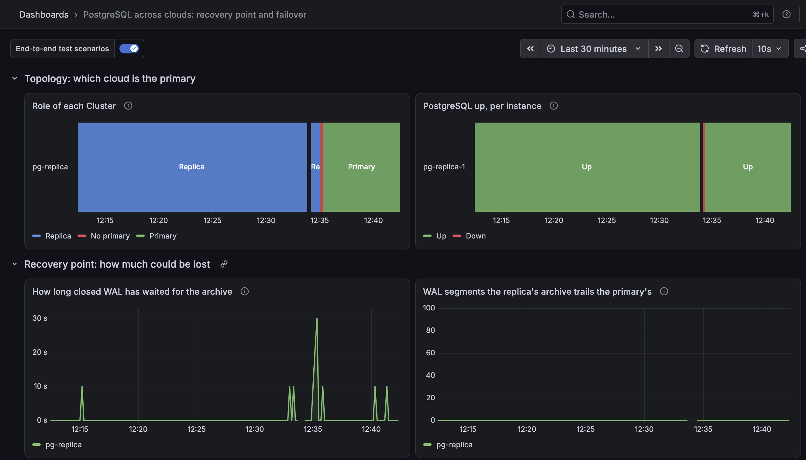
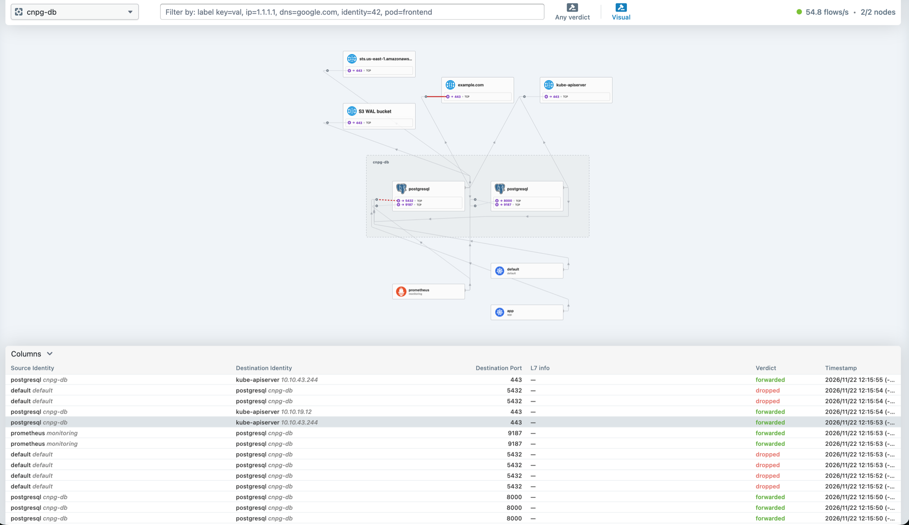
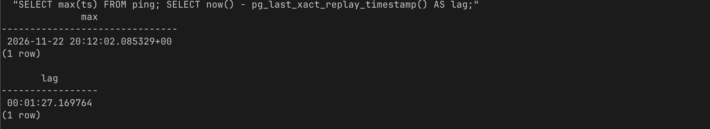

# Live run on EKS and GKE, 2026-11-22

The first deploy to real clusters, followed by the [live drill](../../test/live/run.sh)
([results](20261122T203207Z.md)). Times in the screenshots are US Pacific (UTC-8).
The drill passed 10 of 12 checks. The two failures and the problems found while
deploying were fixed in
[#29](https://github.com/william-stewart/poc-multicloud-postgres/pull/29) and
[#31](https://github.com/william-stewart/poc-multicloud-postgres/pull/31).

## Switchover: GKE becomes the primary

*GKE's dashboard during the drill's planned switchover. `pg-replica` changes from
Replica to Primary at 12:35 after a few seconds with no primary (red), and its pod
restarts once in place. After the promotion it archives its own WAL to GCS, with each
segment waiting at most 30s.*

## Switchover: EKS steps down

*EKS's dashboard at the same moment. `pg-primary` is briefly fenced and then
becomes a replica, so only one cloud ever accepts writes. In this run it couldn't
yet read pg-replica's GCS archive, because its GCS client was missing a project ID.
That was the drill's failed check, fixed in #31. The red block before 12:00 is
`pg-primary-2` still joining during the first deploy.*

## Cilium allows only the named flows

*Hubble on EKS, showing everything in and out of `cnpg-db`. Grey lines are allowed: the
WAL bucket in S3, AWS STS, the Kubernetes API, Prometheus scraping metrics and traffic
between the instances. Red lines are dropped: a PostgreSQL pod reaching out to
`example.com`, and a test pod in the `default` namespace trying to connect on 5432.
`cnpg-db` denies everything by default, so a hostname or client the policy doesn't
name is blocked. The bucket's name is covered because it contains the AWS account ID.*

## WAL archiving and the first backup

*The first deploy on EKS. WAL piled up waiting for the archive until 11:58, because
the egress policy didn't allow S3's global endpoint name, which the backup tool uses
for a `us-east-1` bucket (fixed in #29). Once that was allowed, the queue drained, the
first base backup completed and the cluster was restorable from 11:57.*

## The replica on GKE has the data

*A query against `pg-replica` on GKE returns the latest row written on EKS. The
replica copies data by fetching WAL files from S3, and the primary uploads one at
least every 60s, so it should fall at most about 60s behind, plus transfer time. In the drill, a new row
reached GKE 8.5s after its WAL file was uploaded, and the dashboards' "WAL segments
the replica's archive trails the primary's" panel stayed at 0 throughout. The `lag`
value counts time since the last commit the replica applied, which grows whenever
EKS is idle, so it doesn't measure how far behind the replica is.*
