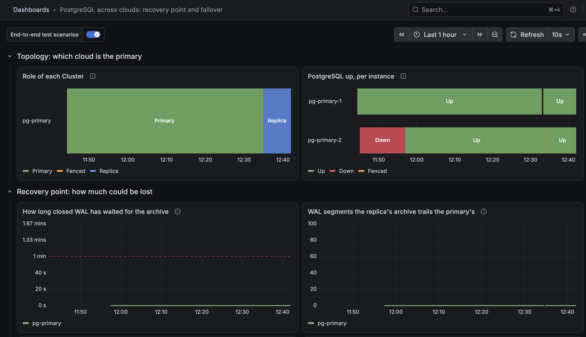
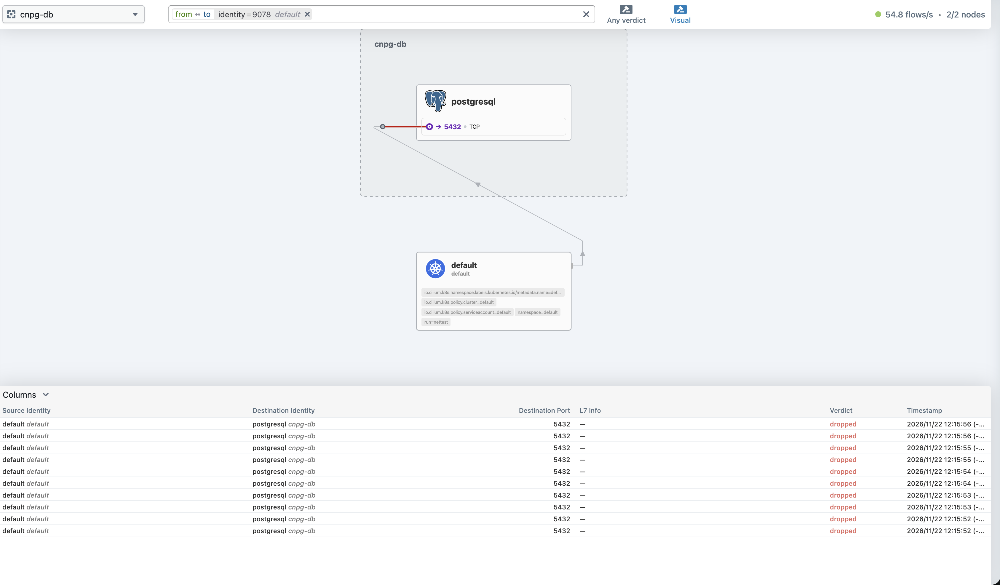
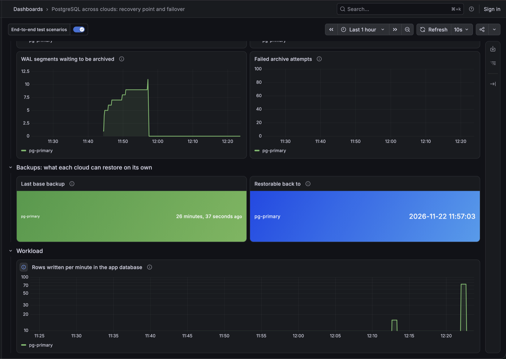

# Live run on EKS and GKE, 2026-11-22

The first deploy to real clusters, followed by the [live drill](../../test/live/run.sh)
([results](20261122T203207Z.md)). Times in the screenshots are US Pacific (UTC-8).
The drill passed 10 of 12 checks. The two failures and the problems found while
deploying were fixed in
[#29](https://github.com/william-stewart/poc-multicloud-postgres/pull/29) and
[#31](https://github.com/william-stewart/poc-multicloud-postgres/pull/31).

## Switchover: GKE becomes the primary

*GKE's dashboard during the drill's planned switchover. `pg-replica` changes from
Replica to Primary at 12:35 after a few seconds with no primary (red), and its pod
restarts once in place. After the promotion it archives its own WAL to GCS, with each
segment waiting at most 30s.*

## Switchover: EKS steps down

*EKS's dashboard at the same moment. `pg-primary` is briefly fenced and then
becomes a replica, so only one cloud ever accepts writes. In this run it couldn't
yet read pg-replica's GCS archive, because its GCS client was missing a project ID.
That was the drill's failed check, fixed in #31. The red block before 12:00 is
`pg-primary-2` still joining during the first deploy.*

## Cilium drops a client the policy doesn't name

*Hubble on EKS. A test pod in the `default` namespace tries to connect to PostgreSQL
on 5432, and every attempt is dropped: `cnpg-db` denies by default and allows only
the `app` namespace, the cluster's own instances, the CNPG operator and Prometheus.*

## WAL archiving and the first backup

*The first deploy on EKS. WAL piled up waiting for the archive until 11:58, because
the egress policy didn't allow S3's global endpoint name, which the backup tool uses
for a `us-east-1` bucket (fixed in #29). Once that was allowed, the queue drained, the
first base backup completed and the cluster was restorable from 11:57.*

## The replica on GKE has the data

*A query against `pg-replica` on GKE returns the latest row written on EKS. `lag` is
the time since the last commit it replayed, so it grows while the primary is idle;
it isn't the replication delay. The drill measures that delay directly: a row
written on EKS was visible on GKE 8.5s after a WAL switch.*
